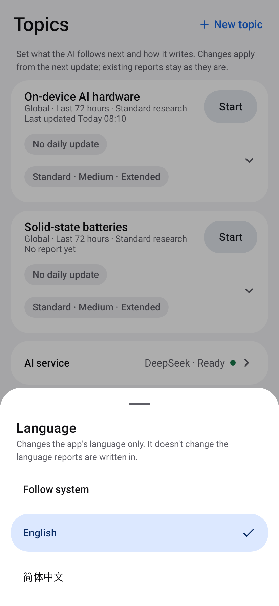
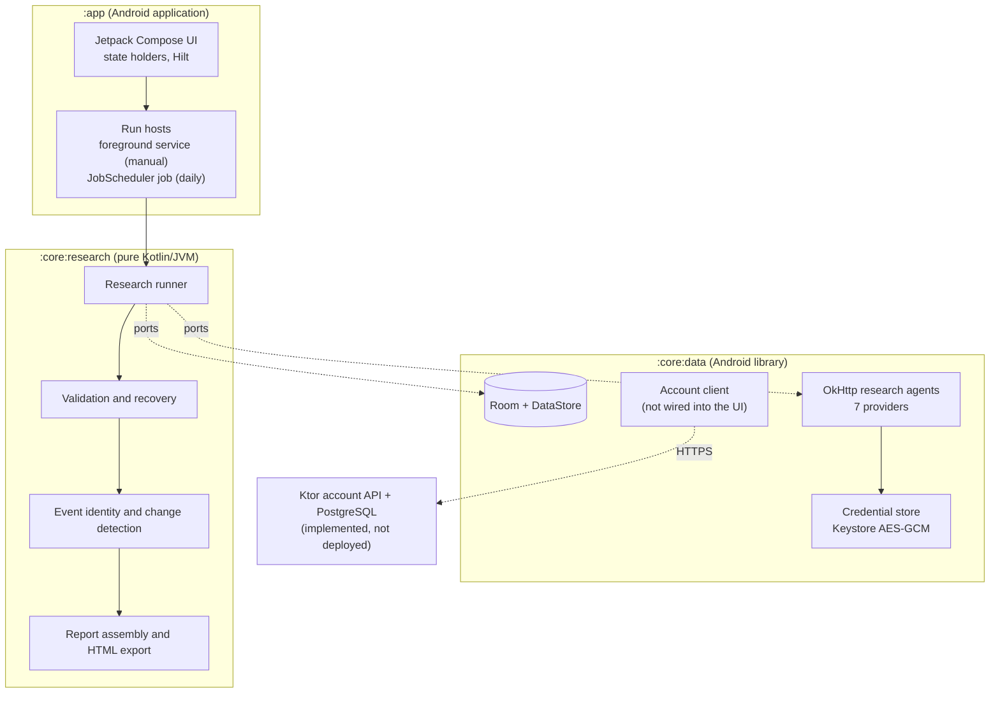

# DailyScope

**English** | [简体中文](README.zh-CN.md)

**AI-powered continuous research and intelligence tracking for Android.**

DailyScope transforms evolving topics into persistent research streams, performing structured research and generating source-backed reports that help users identify meaningful changes.

Someone following a technology, a market or a policy area keeps re-running the same searches to find out what is actually new. In DailyScope each subject is a **topic** with a research brief. On demand, or once a day, the app runs a web-grounded AI research pass, validates the structured result, matches each event against what the topic already knows, and stores a report that separates **new developments** from **updates to events it is already tracking**, each with its sources.

> **About this repository.** This is an engineering portfolio: documentation, architecture diagrams and screenshots of the real app. **The application's source code is private and is not published here.** It is not an open-source project ([NOTICE.md](NOTICE.md)).

---

## Screenshots

<table>
  <tr>
    <td align="center"> Daily</td>
    <td align="center"> Report</td>
    <td align="center"> Topics</td>
    <td align="center"> Language</td>
  </tr>
</table>

*Rendered from the real app's Compose UI by its screenshot test infrastructure (Robolectric + Roborazzi), using fictional test data: the organizations, products, figures and `.example` sources are invented. The report text is English because the test data is; the app's AI currently writes reports in Simplified Chinese, and stored event tags (such as `产品发布`, "product launch") are still Chinese. A [dark-theme report](docs/images/report-dark-en.png) is also included.*

---

## At a glance

| | |
|---|---|
| **Platform** | Native Android, Android 8.0+ (API 26–37), no Google Play Services dependency |
| **Android stack** | Kotlin, Jetpack Compose (Material 3), Hilt, coroutines/Flow, Room, DataStore, OkHttp, kotlinx.serialization, JobScheduler, Android Keystore |
| **Backend stack** | Kotlin, Ktor, PostgreSQL 17, Flyway, JDBC + HikariCP, JWT |
| **AI** | Web-search research with the user's own API key, across seven providers (DeepSeek, Qwen, Zhipu GLM, Kimi, OpenAI, Anthropic Claude, Google Gemini) |
| **Languages** | English and Simplified Chinese UI, with per-app language switching |
| **Status** | Version 0.2.0, a signed APK distributed privately to a small group. Not on Google Play |

---

## Features

- **Persistent research topics.** A topic has a brief: scope, focus areas, exclusions, keywords, regions, a research window and a search depth. The AI can draft the brief from one sentence, or revise it from an instruction.
- **Updates on demand or daily.** `Start` runs one update now. `Daily update` runs one at a chosen time, on a best-effort schedule.
- **Source-backed, change-aware reports.** A focus item, sections and event cards. Each card is marked new or updated and shows its confidence, sources, trends, metrics and what to watch next. A Changes view, past reports and a per-event timeline sit behind it.
- **Output preferences.** `Detail level`, `Length` and `Scope` (27 combinations) shape how events are *written*, never how they are found or identified.
- **Export.** Share or save a report as a self-contained HTML file in one of four presentation styles.
- **Bring your own key.** The user's provider is called directly from the device and bills the user. `Test connection` checks a key before any research runs.

---

## Architecture

- **The research core is pure Kotlin.** It holds all of the product's logic behind small interfaces (ports), and a build check fails on any Android dependency. The same domain test suite runs on a plain JVM and on Android's runtime.
- **`:core:data` implements the ports** on Android: Room, the provider adapters, the Keystore-backed credential store.
- **`:app` decides how a run is hosted.** The runner never knows whether it is in a foreground service, a scheduled job or a test.

More: [Architecture](docs/ARCHITECTURE.md) · [Android](docs/ANDROID_ARCHITECTURE.md) · [Research pipeline](docs/RESEARCH_PIPELINE.md) · [Backend](docs/BACKEND_ARCHITECTURE.md) · [Security](docs/SECURITY.md) · [Testing](docs/TESTING.md)

---

## Engineering highlights

- **Background execution, designed from device evidence.** Before writing the run hosting, a throwaway spike app compared WorkManager expedited work, user-initiated data-transfer jobs and an app-owned foreground service on an Android 16 phone: screen off, app swiped away, notification permission denied, long background periods, and a server that answers only after 10 minutes.
  - The result: manual runs use a `dataSync` foreground service, and a daily run is hosted by the JobScheduler job that triggered it.
  - The spike also showed that Android re-dispatches hosts after process death, and that OkHttp silently re-sends a POST on a dropped pooled connection. Both would repeat a paid AI call.
- **Exactly one paid call per run, by construction.** An atomic claim-once state transition before any network access, a unique identity per scheduled slot, a start-up reconciler for orphaned runs, and no automatic HTTP retries. A run makes at most two provider requests (the call and at most one repair).
- **Structured AI output that is validated, not trusted.** Every reply is parsed and checked against a strict result schema. Truncation is detected from each vendor's stop reason. A complete but malformed reply first gets a deterministic local repair that never invents content, and only then one bounded repair request.
- **Stable event identity across runs.** Sources are canonicalized and events get stable keys. Deterministic rules settle most matches, and ambiguous ones go to an optional model judgement with a deterministic fallback. Writing preferences are kept apart from everything that decides identity.
- **Behavioral parity with golden fixtures.** The research core is a Kotlin port of an earlier Python desktop app by the same author. 737 golden cases generated from that app pin its behavior. 94 hand-authored cases cover Android-only features.
- **Credential security.** API keys are encrypted with AES-256-GCM under a non-exportable Android Keystore key (StrongBox when available), bound to their provider, excluded from backups and redacted from every log. A test scans the app's whole data directory for a canary key.
- **Backend session design.** Short-lived JWT access tokens and opaque refresh tokens that are stored only as hashes and rotated on every refresh. Presenting an old token again revokes the session. One-time activation and refresh races are tested against a real PostgreSQL.
- **Localization done at the resource layer.** English default, Simplified Chinese translation, per-app language through AndroidX. Background-job notifications are localized on Android 8–12 too. Tests fail on a hard-coded UI string or a missing translation.

---

## Testing

Counts from a recorded full run on 2026-10-06 (JDK 21, no build cache, no credentials, no paid calls):

| Kind | Suite | Result |
|---|---|---|
| Unit (pure JVM) | Research core: fixture, specification and unit tests | 1,023 passed, 1 opt-in skipped |
| Integration (Robolectric) | Data layer: Room, DataStore, credentials, the seven provider adapters over MockWebServer, run coordination, account client | 388 passed, 2 live-provider tests skipped |
| UI (Robolectric) | Compose screens on the real data stack, run hosting, scheduling, notifications, localization, contrast | 212 passed, 1 opt-in skipped |
| Screenshot | Roborazzi report scenes, light/dark × default/200 % font | 48 of 48 match |
| Database integration and concurrency | Backend API, activation, sessions, entitlements, migrations on real PostgreSQL 17 | 66 passed |
| Instrumented | Real Android Keystore, and the research-core suite on ART | passed on an API 34 emulator |
| Physical device | Background-execution spike, a scheduled run under forced Doze, the English/Chinese UI | validated on an Android 16 phone |

About 1,700 automated JVM tests in total. Details and limits: [Testing](docs/TESTING.md).

---

## Status

| Area | State |
|---|---|
| Topics, research runs (manual and daily), reports, Changes, history, HTML export | Implemented; in private use |
| Seven bring-your-own-key providers with web search | Implemented |
| English and Simplified Chinese UI | Implemented; validated on an Android 16 phone |
| Account backend (activation, sessions, devices, entitlement read model, admin audit log) | Implemented and tested; **not deployed** |
| Android account client | Implemented and tested; **not connected to any screen** |
| Sign-in UI, hosted AI, usage quotas, payments | **Not implemented** |

## Limitations

- **Report language.** The UI is bilingual, but reports are currently written in Simplified Chinese whatever the UI language.
- **No sign-in yet.** The backend is not deployed, and the app does not call it.
- **Daily updates are best-effort.** Android's battery management decides the exact time.
- **Device coverage.** Emulators (API 26, 30, 34, 37) and one physical phone (Android 16). Manufacturer-specific power management is not yet validated.
- **Distribution.** A privately distributed APK; not published on any app store.

---

## Author

Byron Xia · [github.com/eddf-XIA](https://github.com/eddf-XIA)

Copyright © 2026 Byron Xia. All rights reserved. See [NOTICE.md](NOTICE.md).
