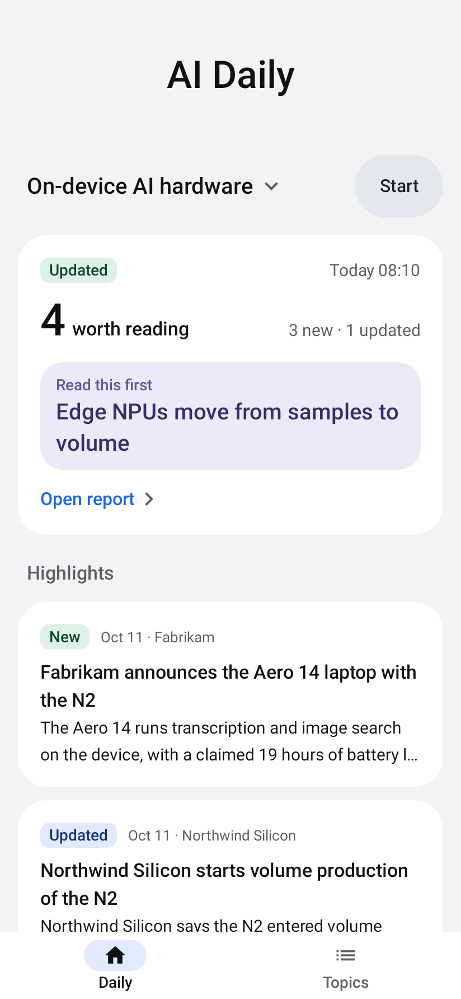
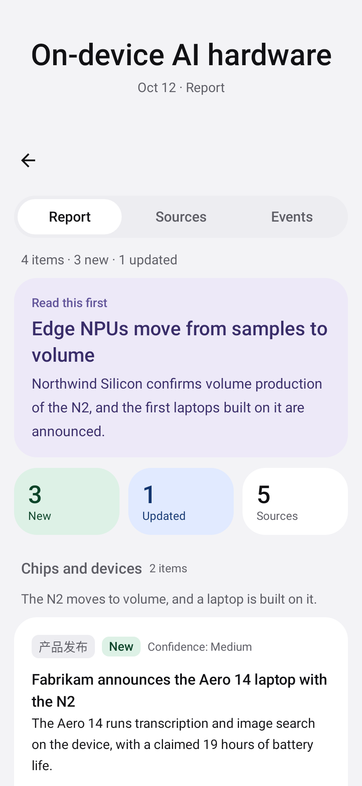
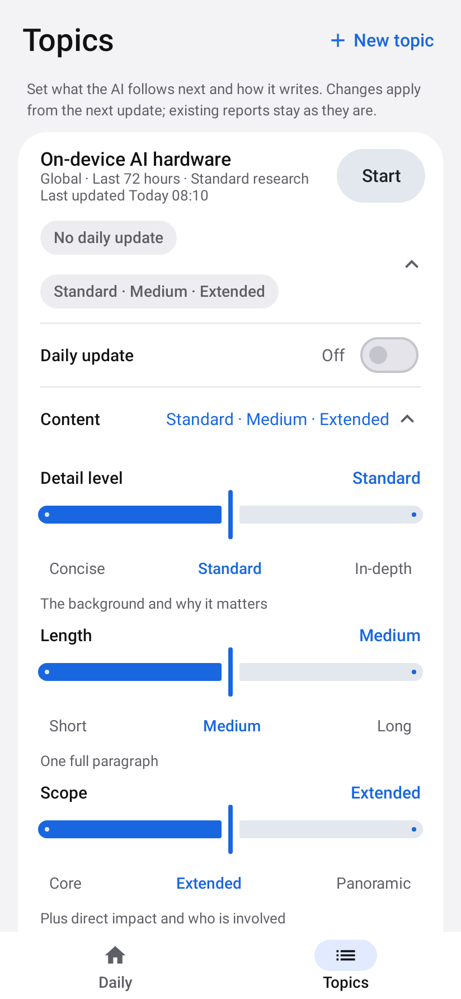
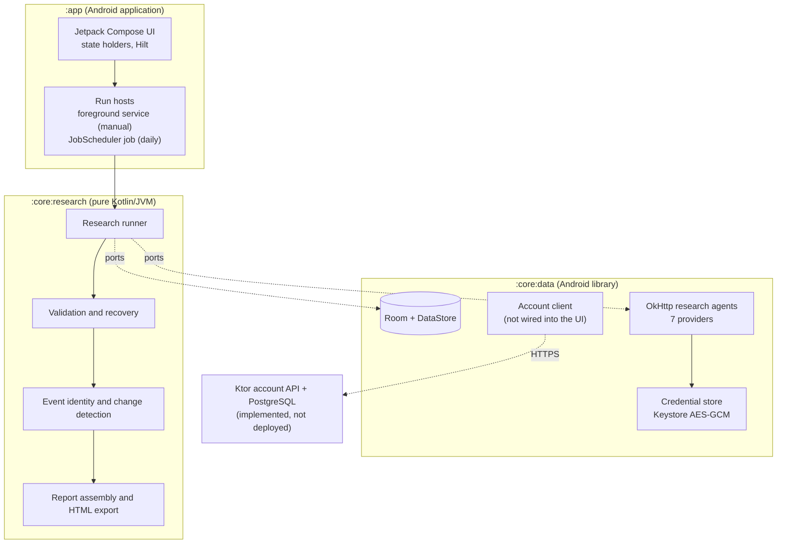

# DailyScope

**English** | [简体中文](README.zh-CN.md)

**AI-powered continuous research and intelligence tracking for Android.**

People who follow a technology, a market or a policy area keep re-running the same searches to find out what is actually new. In DailyScope, each subject is a **topic** with a research brief. On demand or once a day, the app runs a structured, web-grounded AI research pass, validates the result against a strict schema, keeps only findings backed by returned sources, matches each event against what the topic already knows, and stores a readable report that separates **new developments** from **updates to events it is already tracking**.

> **About this repository.** This is an engineering portfolio: documentation, architecture diagrams and screenshots of the real app. **The application's source code is private and is not published here.** It is not an open-source project ([NOTICE.md](NOTICE.md)).

<table>
  <tr>
    <td align="center"> Daily: the latest report at a glance</td>
    <td align="center"> Report: new vs. updated events, with sources</td>
    <td align="center"> Topics: the brief, schedule and preferences</td>
  </tr>
</table>

*Rendered from the real app's Compose UI by its screenshot test infrastructure (Robolectric + Roborazzi), using fictional test data: the organizations, products, figures and `.example` sources are invented. The report text is English because the test data is; the app's AI currently writes reports in Simplified Chinese, and stored event tags (such as `产品发布`, "product launch") are still Chinese. Also included: a [dark-theme report](docs/images/report-dark-en.png) and the [language sheet](docs/images/language-en-zh.png).*

---

## At a glance

| | |
|---|---|
| **What it is** | Continuous, source-backed research on topics the user defines, with change tracking across reports |
| **Platform** | Native Android, Android 8.0+ (API 26–37), no Google Play Services dependency |
| **Android stack** | Kotlin, Jetpack Compose (Material 3), Hilt, coroutines/Flow, Room, DataStore, OkHttp, kotlinx.serialization, JobScheduler, Android Keystore |
| **Backend stack** | Kotlin, Ktor, PostgreSQL 17, Flyway, JDBC + HikariCP, JWT. Implemented and tested; **not deployed** |
| **AI providers** | Seven bring-your-own-key adapters with web search (DeepSeek, Qwen, Zhipu GLM, Kimi, OpenAI, Anthropic Claude, Google Gemini). DeepSeek is validated with live calls; the other six against recorded wire formats |
| **Testing** | 1,689 automated JVM tests in four suites, driven partly by 737 golden and 94 specification fixture cases ([details](#reliability-and-testing)) |
| **My role** | Sole developer: product, architecture, constraints, acceptance and device validation, with AI-assisted implementation ([details](#my-role--ai-assisted-development)) |
| **Status** | Version 0.2.0, a signed APK distributed privately to a small group. Not on Google Play |

### What it does

- **Persistent research topics.** A brief holds the scope, focus areas, exclusions, keywords, regions, research window and search depth. The AI can draft it from one sentence, or revise it from an instruction.
- **Updates on demand or daily.** `Start` runs one update now. `Daily update` runs one at a chosen time, on a best-effort schedule.
- **Source-backed, change-aware reports.** A focus item, sections and event cards, each marked new or updated, with confidence, sources, trends, metrics and what to watch next. A Changes view, past reports and a per-event timeline sit behind it.
- **Output preferences.** `Detail level`, `Length` and `Scope` (27 combinations) shape how events are *written*, never how they are found or identified.
- **Export.** Share or save a report as a self-contained HTML file in one of four presentation styles.
- **Bring your own key.** The user's provider is called directly from the device and bills the user. `Test connection` checks a key before any research runs.

---

## Key engineering achievements

### Research pipeline: model output is validated, not trusted

LLM output can be incomplete, malformed or confidently wrong. DailyScope treats every reply as untrusted input, so that an unreliable response fails visibly instead of silently corrupting stored research.

- **Structured results with schema validation.** The model must return a strict JSON result. It is checked for required fields, types, lengths and list limits before anything is stored.
- **Source-backed evidence.** An event is admissible only through citations that resolve to a source the reply actually returned. Sources are canonicalized and stored once.
- **Truncation is a failure, never a "repair".** A reply cut at the output limit is detected from each vendor's stop reason, and the run fails with a clear reason.
- **Deterministic recovery, then bounded repair.** A complete but unreadable reply first gets a mechanical local repair that keeps the model's text and never invents content. Only if that fails is one repair request sent. There is never a second.
- **Stable event identity and change tracking.** Events get stable keys. Deterministic rules settle clear matches, an optional short model judgement handles ambiguous ones with a rule-based fallback, and when unsure the event is treated as new, because a false "update" is worse than a duplicate. Writing preferences never reach identity, so changing them can't split or merge events.
- **Implemented vs. planned.** Implemented: per-event new/updated marking, a Changes view (new, updated, unchanged, resolved against the previous report) and per-event timelines. Planned: a topic-level state model with richer change types, such as confirmed or reversed developments.

### Android reliability: background work without duplicate paid calls

- **Designed from device evidence.** Before the run hosting was written, a throwaway spike compared WorkManager expedited work, user-initiated data-transfer jobs and an app-owned foreground service on a Galaxy S25 Ultra (Android 16): screen off, app swiped away, notification permission denied, long background periods, and a server that answers only after 10 minutes.
- **The result.** Manual runs use a `dataSync` foreground service, and a daily run is hosted by the JobScheduler job that triggered it, which keeps the process protected until the run ends.
- **The spike found two ways to pay twice.** Android re-dispatches hosts after process death, and OkHttp silently re-sends a POST on a dropped pooled connection.
- **Controlled paid requests.** A run makes **one primary research request**, plus **at most one repair request** if the reply is complete but unreadable. Ambiguous event matches may add short, bounded matching calls (on by default; at most two attempts each; the rules decide if they fail).
- **Nothing re-sends a research request.** Before any network access, an atomic claim-once transition starts the run. Each scheduled slot has a unique identity, a start-up reconciler fails orphaned runs, and OkHttp's silent retry is disabled.
- **Cancellation and failure.** A stopped job or service cancels the call and records the run as failed with a clear reason. Nothing is rescheduled or retried, and only the user can start another run.
- **Checked on the phone.** Under simulated battery and forced Doze, one scheduled slot produced exactly one run and one agent execution. That run made two vendor requests: the primary request and its one permitted repair. There were no duplicates or automatic retries.

### Security

- **On Android, bring-your-own-key credentials.** API keys are encrypted with AES-256-GCM under a non-exportable Android Keystore key (StrongBox when available), bound to their provider by associated data. Room never stores a key, only "a key is saved" and the last four characters. The credential directory is excluded from cloud backup and device transfer, and keys are redacted from every log and error. A test scans the app's whole data directory for a canary key.
- **On the backend, the account foundation (separate, not yet used by the app).** Short-lived JWT access tokens and opaque refresh tokens, stored only as hashes and rotated on every refresh. Presenting a rotated token again revokes the session. The server is the authority for sessions: every authenticated request re-checks the session, device and user, so revocation is immediate.

### Backend foundation (implemented and tested, not deployed)

- **Kotlin/Ktor, PostgreSQL 17, Flyway, plain JDBC with HikariCP.** One service plus an admin CLI.
- **Accounts, sessions and devices** behind a canonical internal user id, with **one-time beta activation codes** (stored only as hashes and claimed in one transaction).
- **An entitlement read model**: plans and capabilities are administrator-defined data, and the server computes capabilities from server time.
- **Invariants in the database.** Check constraints, partial unique indexes and an append-only audit log enforce them.
- **Concurrency tests on real PostgreSQL.** Two concurrent activations of one code create one account, and concurrent refreshes with one token yield at most one new session.
- **Not done.** It is not deployed and not connected to the normal app flow. Hosted research, usage quotas and payments are **not implemented**.

### Parity with the predecessor, pinned by fixtures

The research core reproduces the behavior of DailyScope's Python predecessor ([Project evolution](#project-evolution)). 737 golden cases, generated deterministically from the unmodified Python app, pin it; 94 hand-authored cases cover Android-only features. When Kotlin disagrees with a golden case, Kotlin is wrong, unless an intentional difference is recorded as an explicit override in the data.

---

## Architecture

- **The research core is pure Kotlin.** It holds all of the product's logic behind small interfaces (ports), and a build check fails on any Android dependency. The same domain test suite runs on a plain JVM and on Android's runtime.
- **`:core:data` implements the ports** on Android: Room, the provider adapters, the Keystore-backed credential store.
- **`:app` decides how a run is hosted.** The runner never knows whether it is in a foreground service, a scheduled job or a test.

---

## Reliability and testing

Counts from a recorded full run on 2026-10-06 (JDK 21, no build cache, no credentials, no paid calls):

| Kind | Suite | Result |
|---|---|---|
| Unit (pure JVM) | Research core: fixture, specification and unit tests | 1,023 passed, 1 opt-in skipped |
| Integration (Robolectric) | Data layer: Room, DataStore, credentials, the seven provider adapters over MockWebServer, run coordination, account client | 388 passed, 2 live-provider tests skipped |
| UI (Robolectric) | Compose screens on the real data stack, run hosting, scheduling, notifications, localization, contrast | 212 passed, 1 opt-in skipped |
| Database integration and concurrency | Backend API, activation, sessions, entitlements, migrations on real PostgreSQL 17 | 66 passed |
| Screenshot comparison | 48 report images (light/dark × default/200 % font), from 4 of the 212 UI tests | 48 of 48 match their baselines |
| Instrumented | Real Android Keystore, and the research-core suite on ART | 2 tests and 965 research-core checks passed on an API 34 emulator |
| Physical device | Background-execution spike, a scheduled run under forced Doze, walkthroughs, the English/Chinese UI | Galaxy S25 Ultra (Android 16) |

- **1,689 test cases** across the four JVM suites (1,023 + 388 + 212 + 66). The screenshot comparisons and the on-device checks are not added: they come from tests already counted or re-run them.
- **Fixture cases are test data, not tests.** The 737 golden and 94 specification cases drive tests in those suites.
- **Live tests.** The two skipped data-layer tests call DeepSeek for real. They run only when explicitly enabled, because they are billable.
- **Added later.** Five opt-in tests that render these portfolio screenshots were added after this run. They are skipped by default.

Details, selected tests and limits: [Testing](docs/TESTING.md).

---

## My Role & AI-Assisted Development

I started DailyScope as a Python desktop project for monitoring research topics, and evolved it into a native Android app with a separate Kotlin backend foundation. I am its only human developer. My part:

- **Product and requirements.** What the app is for, what each screen must answer, and what a report may and may not claim.
- **Architecture and technology.** A pure-Kotlin research core behind ports, local-first storage, bring-your-own-key calls from the device, no Google Play Services, and a separate Ktor/PostgreSQL backend.
- **Reliability and privacy constraints.** No duplicated paid calls, no plaintext keys, model output treated as untrusted input, and parity with the Python app pinned by golden fixtures.
- **Direction and acceptance.** The phase plan, each phase's acceptance criteria and the design decisions recorded along the way. A phase counted as complete only when its criteria and tests passed.
- **Validation on a real phone.** All on my own Galaxy S25 Ultra:
  - hands-on walkthroughs of the milestone builds;
  - the background-execution and scheduling checks;
  - approval of every paid, live research call.

**AI-assisted development.** DailyScope was built with Claude Code (Anthropic's AI coding agent), which wrote much of its code, tests and documentation, including these pages, under my direction. Nearly every commit in the private repository is co-authored by it. Architectural decisions, acceptance criteria, validation priorities and release approval stayed with me. Correctness rests on the automated tests, the reproducible fixtures and the device checks described above, not on trust in AI-written code.

### Project evolution

DailyScope originated as **AIOS Intelligence Monitor**, a local Python/FastAPI app (with SQLite) for researching topics and tracking events across runs. DailyScope rebuilt its focused, simplified research workflow as a native Kotlin Android app.

- **Ported, and pinned by fixtures:** the research behavior, that is normalization, event identity and matching, change classification, result validation and the report views. It lives in a pure-Kotlin core, pinned by 737 golden cases generated from the unmodified Python app. Intentional differences are recorded as explicit overrides.
- **Redesigned for Android:** run execution, scheduling, storage, credential security and the whole UI.
- **Not ported:** not every desktop feature was carried over.

The desktop app remains the behavioral reference and is not published.

---

## Status

| Area | State |
|---|---|
| Topics, research runs (manual and daily), reports, Changes, history, HTML export | Implemented; in private use |
| Per-event change tracking (new/updated, Changes view, timelines) | Implemented |
| Topic-level state model with richer change types | Planned |
| Seven bring-your-own-key providers with web search | Implemented; DeepSeek validated live, the others against recorded wire formats |
| English and Simplified Chinese UI | Implemented; validated on a Galaxy S25 Ultra |
| Account backend (activation, sessions, devices, entitlement read model, admin audit log) | Implemented and tested; **not deployed** |
| Android account client | Implemented and tested; **not connected to any screen** |
| Sign-in UI, hosted AI, usage quotas, payments | **Not implemented** |

## Limitations

- **Report language.** The UI is bilingual, but reports are currently written in Simplified Chinese whatever the UI language.
- **Discovery depends on the provider's web search.** Ingesting chosen sources directly is not implemented.
- **Matching is conservative.** When unsure, an event is treated as new, so a development can occasionally appear twice rather than be merged wrongly.
- **Live provider coverage.** Only DeepSeek has been exercised with real calls; the other six adapters are verified against recorded wire formats.
- **No sign-in yet.** The backend is not deployed, and the app does not call it.
- **Daily updates are best-effort.** Android's battery management decides the exact time.
- **Device coverage.** Emulators (API 26, 30, 34, 37) and one physical phone (Galaxy S25 Ultra, Android 16). Manufacturer-specific power management on other brands is not yet validated.
- **Distribution.** A privately distributed APK; not published on any app store.

---

## Documentation

- [Architecture](docs/ARCHITECTURE.md): modules, design decisions, implemented vs. planned
- [Android](docs/ANDROID_ARCHITECTURE.md): Compose, persistence, background execution, credentials, localization
- [Research pipeline](docs/RESEARCH_PIPELINE.md): the stages of a run and what each one guarantees
- [Backend](docs/BACKEND_ARCHITECTURE.md): the account API, sessions, database constraints, entitlement read model
- [Security](docs/SECURITY.md): what is protected, and what is not claimed
- [Testing](docs/TESTING.md): recorded results, fixtures, selected tests, device validation

---

## Author

Byron Xia · [github.com/eddf-XIA](https://github.com/eddf-XIA)

Copyright © 2026 Byron Xia. All rights reserved. See [NOTICE.md](NOTICE.md).
