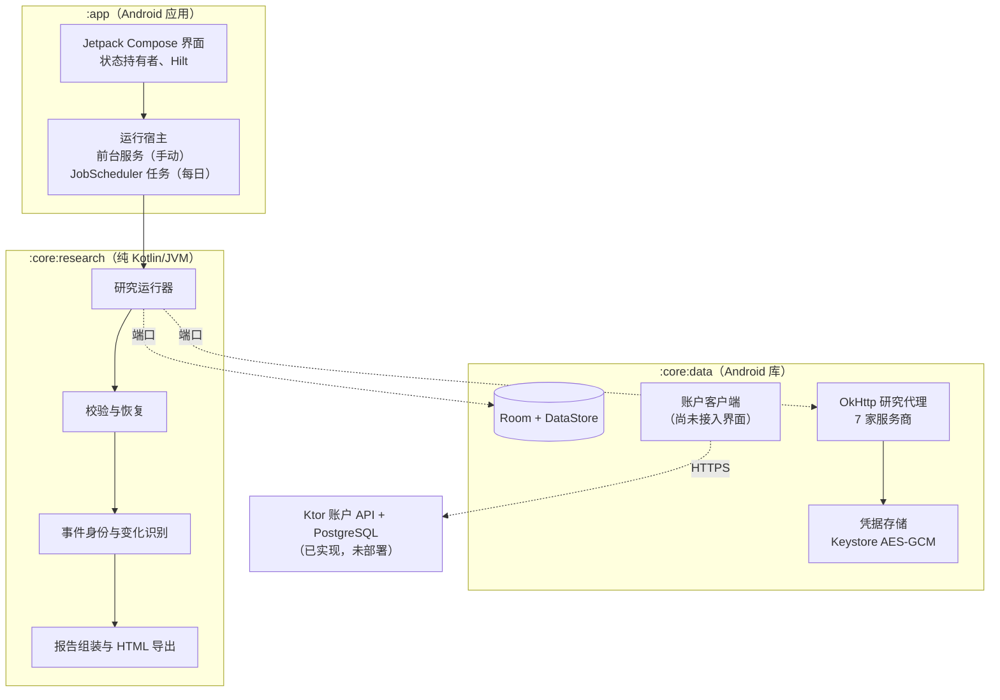

# DailyScope

[English](README.md) | **简体中文**

**面向 Android 的 AI 持续研究与情报追踪应用。**

DailyScope 把不断变化的主题变成持续的研究流：对每个主题进行结构化研究，生成有来源支撑的报告，帮助用户看清真正发生了哪些变化。

关注某项技术、某个市场或某个政策领域的人，往往要反复做同样的搜索，才能弄清到底有什么新进展。在 DailyScope 里，每个关注对象都是一个带研究简报的**主题**。用户可以随时开始一次更新，也可以让它每天定时运行：应用会进行一次基于网络检索的 AI 研究，校验结构化结果，把每个事件与该主题已知的事件比对，最后保存一份报告，把**新动态**和**已追踪事件的更新**分开呈现，并附上各自的来源。

> **关于本仓库：** 这是一个工程作品集，包含真实应用的文档、架构图和截图。**应用源代码是私有的，不在此发布。** 本项目不是开源项目（见 [NOTICE.md](NOTICE.md)）。

---

## 截图

<table>
  <tr>
    <td align="center"> 日报</td>
    <td align="center"> 报告</td>
    <td align="center"> 主题</td>
    <td align="center"> 语言</td>
  </tr>
</table>

*以上画面由真实应用的 Compose 界面经其截图测试设施（Robolectric + Roborazzi）渲染，使用的是虚构测试数据：机构、产品、数字和 `.example` 来源均为编造。截图为英文界面；报告正文之所以是英文，是因为测试数据是英文的。目前应用的 AI 以简体中文撰写报告，已保存的事件标签（如 `产品发布`）也仍是中文。另附一张[深色主题报告截图](docs/images/report-dark-en.png)。*

---

## 概览

| | |
|---|---|
| **平台** | 原生 Android，Android 8.0 及以上（API 26–37），不依赖 Google Play 服务 |
| **Android 技术栈** | Kotlin、Jetpack Compose（Material 3）、Hilt、协程 / Flow、Room、DataStore、OkHttp、kotlinx.serialization、JobScheduler、Android Keystore |
| **后端技术栈** | Kotlin、Ktor、PostgreSQL 17、Flyway、JDBC + HikariCP、JWT |
| **AI** | 使用用户自己的 API Key 进行联网检索研究，支持七家服务商（DeepSeek、通义千问、智谱 GLM、Kimi、OpenAI、Anthropic Claude、Google Gemini） |
| **界面语言** | 英文与简体中文，支持应用内单独切换语言 |
| **状态** | 0.2.0 版本，以签名 APK 形式小范围私下分发，未上架 Google Play |

---

## 功能

- **持续的研究主题。** 每个主题都有研究简报：范围、关注重点、排除项、关键词、地区、研究时间窗和检索深度。AI 可以根据一句话起草简报，也可以按指令修改。
- **随时更新或每日更新。** `开始` 立即运行一次更新；`每天更新` 在设定时间运行，时间为尽力而为。
- **有来源、能看出变化的报告。** 包括焦点、分节和事件卡片。每张卡片标明是新增还是更新，并显示可信度、来源、趋势、数据和后续关注点。另有变化视图、往期日报和单个事件的时间线。
- **输出偏好。** `详细程度`、`单条篇幅` 和 `内容范围`（共 27 种组合）只影响事件*怎么写*，从不影响事件如何被发现或识别。
- **导出。** 报告可分享或保存为独立的 HTML 文件，有四种呈现样式。
- **自带 Key。** 应用从设备直接调用用户自己的服务商，费用由用户的服务商账户结算。研究开始前可用 `测试连接` 检查 Key。

---

## 架构

- **研究核心是纯 Kotlin。** 产品逻辑全部位于一组小接口（端口）之后；构建检查会拒绝任何 Android 依赖。同一套领域测试既在普通 JVM 上运行，也在 Android 运行时上运行。
- **`:core:data` 在 Android 上实现这些端口**：Room、各服务商适配器、基于 Keystore 的凭据存储。
- **`:app` 决定一次运行由谁承载。** 运行器不知道自己运行在前台服务、定时任务还是测试中。

详细文档（英文）：[架构](docs/ARCHITECTURE.md) · [Android](docs/ANDROID_ARCHITECTURE.md) · [研究流程](docs/RESEARCH_PIPELINE.md) · [后端](docs/BACKEND_ARCHITECTURE.md) · [安全](docs/SECURITY.md) · [测试](docs/TESTING.md)

---

## 工程亮点

- **以真机证据设计后台执行。** 在编写运行宿主之前，先用一个一次性的实验应用，在一台 Android 16 手机上对比了 WorkManager 加急任务、用户发起的数据传输任务和应用自有的前台服务。测试条件包括息屏、从最近任务划掉、拒绝通知权限、长时间后台，以及一台 10 分钟后才响应的服务器。
  - 结论：手动运行使用 `dataSync` 前台服务；每日运行由触发它的 JobScheduler 任务自己承载。
  - 实验还发现：进程被杀后 Android 会重新派发宿主，OkHttp 也会在复用连接断开时悄悄重发 POST。两者都会重复一次付费的 AI 调用。
- **从结构上保证每次运行只有一次付费调用。** 任何网络访问之前先做原子的"只认领一次"状态转换；每个定时时段有唯一身份；启动时由协调器收尾孤立的运行；HTTP 不自动重试。一次运行最多两次服务商请求（调用本身，加最多一次修复）。
- **对 AI 结构化输出做校验，而不是直接信任。** 每个回复都按严格的结果结构解析和校验；根据各服务商的停止原因识别被截断的回复；完整但格式有误的回复先经过一次不编造内容的确定性本地修复，之后才会发出唯一一次有界的修复请求。
- **跨运行的稳定事件身份。** 来源先规范化，事件获得稳定的键。多数匹配由确定性规则判定，模糊情况交给可选的模型判断，并有确定性兜底。写作偏好与所有决定身份的数据严格分开。
- **用 golden fixtures 保证行为一致。** 研究核心是作者早先一个 Python 桌面应用的 Kotlin 移植。由原应用生成的 737 个 golden 用例固定了它的行为；另有 94 个手写用例覆盖 Android 独有功能。
- **凭据安全。** API Key 用不可导出的 Android Keystore 密钥（设备支持时使用 StrongBox）以 AES-256-GCM 加密，并与所属服务商绑定；不参与备份，并从所有日志中脱敏。有测试会在应用的整个数据目录中搜索一个金丝雀 Key。
- **后端会话设计。** 短时效的 JWT 访问令牌，加上只以哈希形式保存、每次刷新都轮换的不透明刷新令牌；旧令牌被再次使用时会吊销整个会话。一次性激活和刷新的并发竞争都在真实 PostgreSQL 上测试。
- **在资源层完成本地化。** 英文为默认，简体中文为翻译，通过 AndroidX 实现应用内语言切换。Android 8–12 上后台任务的通知同样会本地化。出现硬编码界面文字或缺失翻译时测试会失败。

---

## 测试

以下数字来自 2026-10-06 的一次完整运行记录（JDK 21，无构建缓存，无凭据，无付费调用）：

| 类型 | 测试套件 | 结果 |
|---|---|---|
| 单元测试（纯 JVM） | 研究核心：fixture、规格与单元测试 | 1,023 通过，1 个按需跳过 |
| 集成测试（Robolectric） | 数据层：Room、DataStore、凭据、七家服务商适配器（MockWebServer）、运行协调、账户客户端 | 388 通过，2 个真实服务商测试跳过 |
| 界面测试（Robolectric） | 基于真实数据栈的 Compose 界面、运行宿主、调度、通知、本地化、对比度 | 212 通过，1 个按需跳过 |
| 截图测试 | Roborazzi 报告场景，浅色/深色 × 默认/200 % 字号 | 48 张全部一致 |
| 数据库集成与并发 | 后端 API、激活、会话、权益、迁移，运行于真实 PostgreSQL 17 | 66 通过 |
| 仪器测试 | 真实 Android Keystore，以及在 ART 上运行研究核心测试 | 在 API 34 模拟器上通过 |
| 真机验证 | 后台执行实验、强制 Doze 下的定时运行、中英文界面 | 在一台 Android 16 手机上验证 |

自动化 JVM 测试共约 1,700 个。细节与局限见 [Testing](docs/TESTING.md)（英文）。

---

## 状态

| 方面 | 状态 |
|---|---|
| 主题、研究运行（手动与每日）、报告、变化、历史、HTML 导出 | 已实现，私下使用中 |
| 七家自带 Key 的联网检索服务商 | 已实现 |
| 英文与简体中文界面 | 已实现，已在 Android 16 手机上验证 |
| 账户后端（激活、会话、设备、权益读取模型、管理审计日志） | 已实现并测试，**未部署** |
| Android 账户客户端 | 已实现并测试，**尚未接入任何界面** |
| 登录界面、托管 AI、用量配额、支付 | **未实现** |

## 局限

- **报告语言。** 界面是双语的，但报告目前无论界面语言如何都以简体中文撰写。
- **暂无登录。** 后端未部署，应用也不调用它。
- **每日更新为尽力而为。** 具体时间由 Android 的电池管理决定。
- **设备覆盖。** 模拟器（API 26、30、34、37）和一台真机（Android 16）。厂商定制系统的电源管理尚未验证。
- **分发。** 私下分发的 APK，未在任何应用商店上架。

---

## 作者

Byron Xia · [github.com/eddf-XIA](https://github.com/eddf-XIA)

Copyright © 2026 Byron Xia. 保留所有权利。见 [NOTICE.md](NOTICE.md)。
