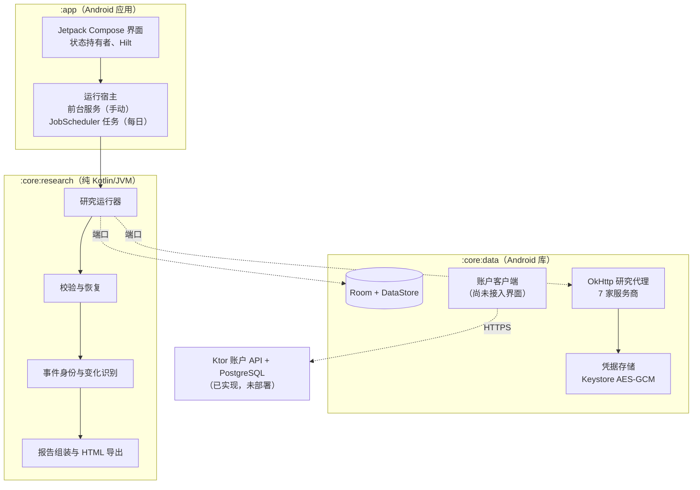

# DailyScope

[English](README.md) | **简体中文**

**面向 Android 的 AI 持续研究与情报追踪应用。**

关注某项技术、某个市场或某个政策领域的人，往往要反复做同样的搜索，才能弄清到底有什么新进展。在 DailyScope 里，每个关注对象都是一个带研究简报的**主题**。用户可以随时开始一次更新，也可以让它每天定时运行：应用会进行一次结构化、基于网络检索的 AI 研究，按严格的结构校验结果，只保留有返回来源支撑的发现，把每个事件与该主题已知的事件比对，最后保存一份易读的报告，把**新动态**和**已追踪事件的更新**分开呈现。

> **关于本仓库：** 这是一个工程作品集，包含真实应用的文档、架构图和截图。**应用源代码是私有的，不在此发布。** 本项目不是开源项目（见 [NOTICE.md](NOTICE.md)）。

<table>
  <tr>
    <td align="center"> 日报：一眼看到最新报告</td>
    <td align="center"> 报告：新增与更新分开，附来源</td>
    <td align="center"> 主题：简报、定时与输出偏好</td>
  </tr>
</table>

*以上画面由真实应用的 Compose 界面经其截图测试设施（Robolectric + Roborazzi）渲染，使用的是虚构测试数据：机构、产品、数字和 `.example` 来源均为编造。截图为英文界面；报告正文之所以是英文，是因为测试数据是英文的。目前应用的 AI 以简体中文撰写报告，已保存的事件标签（如 `产品发布`）也仍是中文。另附[深色主题报告](docs/images/report-dark-en.png)和[语言选择](docs/images/language-en-zh.png)截图。*

---

## 概览

| | |
|---|---|
| **定位** | 针对用户自定主题的持续研究，结论有来源支撑，并跨报告追踪变化 |
| **平台** | 原生 Android，Android 8.0 及以上（API 26–37），不依赖 Google Play 服务 |
| **Android 技术栈** | Kotlin、Jetpack Compose（Material 3）、Hilt、协程 / Flow、Room、DataStore、OkHttp、kotlinx.serialization、JobScheduler、Android Keystore |
| **后端技术栈** | Kotlin、Ktor、PostgreSQL 17、Flyway、JDBC + HikariCP、JWT。已实现并测试，**未部署** |
| **AI 服务商** | 七个自带 Key 的联网检索适配器（DeepSeek、通义千问、智谱 GLM、Kimi、OpenAI、Anthropic Claude、Google Gemini）。DeepSeek 经过真实调用验证，其余六家依据录制的接口格式验证 |
| **测试** | 四个套件共 1,689 个自动化 JVM 测试，部分由 737 个 golden 用例和 94 个规格用例驱动（[详情](#可靠性与测试)） |
| **我的角色** | 独立开发者：负责产品、架构、约束、验收与真机验证，代码实现借助 AI 辅助完成（[详情](#我的角色与-ai-辅助开发)） |
| **状态** | 0.2.0 版本，以签名 APK 形式小范围私下分发，未上架 Google Play |

### 功能

- **持续的研究主题。** 简报包括范围、关注重点、排除项、关键词、地区、研究时间窗和检索深度。AI 可以根据一句话起草简报，也可以按指令修改。
- **随时更新或每日更新。** `开始` 立即运行一次更新；`每天更新` 在设定时间运行，时间为尽力而为。
- **有来源、能看出变化的报告。** 包括焦点、分节和事件卡片。每张卡片标明是新增还是更新，并显示可信度、来源、趋势、数据和后续关注点。另有变化视图、往期日报和单个事件的时间线。
- **输出偏好。** `详细程度`、`单条篇幅` 和 `内容范围`（共 27 种组合）只影响事件*怎么写*，从不影响事件如何被发现或识别。
- **导出。** 报告可分享或保存为独立的 HTML 文件，有四种呈现样式。
- **自带 Key。** 应用从设备直接调用用户自己的服务商，费用由用户的服务商账户结算。研究开始前可用 `测试连接` 检查 Key。

---

## 主要工程成果

### 研究流程：对模型输出做校验，而不是直接信任

LLM 的输出可能不完整、格式错误，甚至言之凿凿地出错。DailyScope 把每个回复都当作不可信输入，让不可靠的回复明确地失败，而不是悄悄污染已保存的研究结果。

- **结构化结果与结构校验。** 模型必须返回严格的 JSON 结果；保存任何内容之前，先检查必填字段、类型、长度和列表上限。
- **有来源支撑的证据。** 事件只有在其引用能对应到回复实际返回的来源时才会被接受。来源先规范化，只保存一次。
- **截断就是失败，绝不"修复"。** 根据各服务商的停止原因识别在输出上限处被截断的回复，并以清楚的原因结束本次运行。
- **先确定性恢复，再有界修复。** 完整但无法读取的回复，先经过一次机械的本地修复：保留模型原文，从不编造内容。只有这一步失败，才会发出一次修复请求，绝不会有第二次。
- **稳定的事件身份与变化追踪。** 事件获得稳定的键。清楚的匹配由确定性规则判定；模糊的情况交给可选的简短模型判断，并有基于规则的兜底；拿不准时一律视为新事件，因为错误的"更新"比重复更糟。写作偏好从不参与身份判定，所以改变偏好不会拆分或合并事件。
- **已实现与计划中。** 已实现：逐事件标注新增 / 更新、变化视图（相对上一份报告分为新增、更新、未变化、已结束）以及单个事件的时间线。计划中：主题层面的状态模型，以及更丰富的变化类型，例如"得到证实"或"出现反转"。

### Android 可靠性：后台运行，且不重复付费调用

- **以真机证据设计。** 在编写运行宿主之前，先用一个一次性的实验应用，在一台 Galaxy S25 Ultra（Android 16）上对比了 WorkManager 加急任务、用户发起的数据传输任务和应用自有的前台服务。测试条件包括息屏、从最近任务划掉、拒绝通知权限、长时间后台，以及一台 10 分钟后才响应的服务器。
- **结论。** 手动运行使用 `dataSync` 前台服务；每日运行由触发它的 JobScheduler 任务自己承载，在运行结束前进程一直受到保护。
- **实验发现了两种重复付费的途径。** 进程被杀后 Android 会重新派发宿主；OkHttp 会在复用连接断开时悄悄重发 POST。
- **受控的付费请求。** 一次运行发出**一次主研究请求**；若回复完整但无法读取，再加**最多一次修复请求**。遇到模糊的事件匹配时，还可能发出简短、有上限的匹配请求（默认开启；每次最多尝试两次；失败时由规则决定）。
- **研究请求绝不重发。** 在任何网络访问之前，先做原子的"只认领一次"状态转换来启动运行。每个定时时段有唯一身份，启动时的协调器会把孤立的运行判为失败，OkHttp 的静默重试也已关闭。
- **取消与失败处理。** 任务或服务被系统停止时，会取消调用，并以清楚的原因把运行记为失败。不会重新安排或重试，只有用户能开始下一次运行。
- **在真机上检查过。** 在模拟电池供电、强制 Doze 的条件下，一个定时时段只产生一次运行和一次代理执行。这次运行发出两次服务商请求：主请求和它唯一允许的修复请求。没有重复，也没有自动重试。

### 安全

- **Android 端：自带 Key 的凭据。** API Key 用不可导出的 Android Keystore 密钥（设备支持时使用 StrongBox）以 AES-256-GCM 加密，并通过关联数据与所属服务商绑定。Room 从不保存 Key，只记录"已保存 Key"和末四位。凭据目录不参与云备份和设备迁移，Key 会从所有日志和错误信息中脱敏。有测试会在应用的整个数据目录中搜索一个金丝雀 Key。
- **后端：账户基础（独立部分，应用尚未使用）。** 短时效的 JWT 访问令牌，加上只以哈希形式保存、每次刷新都轮换的不透明刷新令牌；已轮换的令牌被再次使用时会吊销会话。会话以服务端为准：每个需认证的请求都会重新检查会话、设备和用户，因此吊销立即生效。

### 后端基础（已实现并测试，未部署）

- **Kotlin/Ktor、PostgreSQL 17、Flyway，以及纯 JDBC 加 HikariCP。** 一个服务，外加一个管理命令行工具。
- **账户、会话与设备**都挂在一个规范的内部用户 ID 之下，并支持**一次性内测激活码**（只保存哈希，在单个事务中认领）。
- **权益读取模型**：套餐和能力是管理员定义的数据，能力由服务端按服务器时间计算。
- **不变量由数据库保证。** CHECK 约束、部分唯一索引和只能追加的审计日志共同保证这些不变量。
- **在真实 PostgreSQL 上做并发测试。** 同一激活码的两次并发激活只会创建一个账户；用同一令牌并发刷新，最多产生一个新会话。
- **尚未完成。** 后端未部署，也未接入应用的正常流程。托管研究、用量配额和支付都**未实现**。

### 以 fixtures 保证与前身的一致性

研究核心复现了 DailyScope 的 Python 前身的行为（见[项目演进](#项目演进)）。由未经修改的 Python 应用以确定性方式生成的 737 个 golden 用例固定了这些行为；另有 94 个手写用例覆盖 Android 独有功能。Kotlin 与 golden 用例不一致时，以 Kotlin 有误论处，除非这一有意差异已在数据中记为显式覆盖。

---

## 架构

- **研究核心是纯 Kotlin。** 产品逻辑全部位于一组小接口（端口）之后；构建检查会拒绝任何 Android 依赖。同一套领域测试既在普通 JVM 上运行，也在 Android 运行时上运行。
- **`:core:data` 在 Android 上实现这些端口**：Room、各服务商适配器、基于 Keystore 的凭据存储。
- **`:app` 决定一次运行由谁承载。** 运行器不知道自己运行在前台服务、定时任务还是测试中。

---

## 可靠性与测试

以下数字来自 2026-10-06 的一次完整运行记录（JDK 21，无构建缓存，无凭据，无付费调用）：

| 类型 | 测试套件 | 结果 |
|---|---|---|
| 单元测试（纯 JVM） | 研究核心：fixture、规格与单元测试 | 1,023 通过，1 个按需跳过 |
| 集成测试（Robolectric） | 数据层：Room、DataStore、凭据、七家服务商适配器（MockWebServer）、运行协调、账户客户端 | 388 通过，2 个真实服务商测试跳过 |
| 界面测试（Robolectric） | 基于真实数据栈的 Compose 界面、运行宿主、调度、通知、本地化、对比度 | 212 通过，1 个按需跳过 |
| 数据库集成与并发 | 后端 API、激活、会话、权益、迁移，运行于真实 PostgreSQL 17 | 66 通过 |
| 截图比对 | 48 张报告画面（浅色/深色 × 默认/200 % 字号），来自上述 212 个界面测试中的 4 个 | 48 张全部与基准一致 |
| 仪器测试 | 真实 Android Keystore，以及在 ART 上运行研究核心测试 | 在 API 34 模拟器上，2 个测试和 965 项研究核心检查通过 |
| 真机验证 | 后台执行实验、强制 Doze 下的定时运行、操作走查、中英文界面 | Galaxy S25 Ultra（Android 16） |

- **四个 JVM 套件共 1,689 个测试用例**（1,023 + 388 + 212 + 66）。截图比对和设备上的检查没有计入：它们来自已计入的测试，或是重新运行这些测试。
- **Fixture 用例是测试数据，不是测试。** 737 个 golden 用例和 94 个规格用例驱动的是上述套件中的测试。
- **真实调用测试。** 数据层中被跳过的两个测试会真实调用 DeepSeek，会产生费用，只有明确开启时才运行。
- **后来新增。** 这次运行之后，又新增了 5 个按需运行的测试，用来渲染本作品集的截图，默认跳过。

细节、精选测试与局限见 [Testing](docs/TESTING.md)（英文）。

---

## 我的角色与 AI 辅助开发

DailyScope 起步于我做的一个 Python 桌面项目，用于持续监测研究主题；之后我把它发展成原生 Android 应用，并另建了一个 Kotlin 后端基础。我是这个项目唯一的人类开发者。我负责：

- **产品与需求。** 应用要解决什么问题、每个页面要回答什么、一份报告可以说什么、不能说什么。
- **架构与技术选型。** 以端口隔离的纯 Kotlin 研究核心、本地优先的存储、从设备直接调用用户自带 Key 的服务商、不依赖 Google Play 服务，以及独立的 Ktor/PostgreSQL 后端。
- **可靠性与隐私约束。** 不重复付费调用、不以明文保存 Key、把模型输出当作不可信输入，并用 golden fixtures 固定与 Python 应用的行为一致。
- **方向与验收。** 阶段计划、每个阶段的验收标准，以及过程中记录下来的设计决策。一个阶段只有在验收标准和测试全部通过后才算完成。
- **真机验证。** 都在我自己的 Galaxy S25 Ultra 上进行：
  - 对各里程碑版本的亲手走查；
  - 后台执行与定时调度的检查；
  - 每一次付费的真实研究调用都经我批准。

**AI 辅助开发。** DailyScope 借助 Claude Code（Anthropic 的 AI 编程代理）开发，它在我的指导下编写了大部分代码、测试和文档，包括这些页面。私有仓库中几乎每个提交都有它的共同署名。架构决策、验收标准、验证重点和发布批准始终由我掌握。正确性依靠上面介绍的自动化测试、可复现的 fixtures 和真机检查来保证，而不是默认相信 AI 写的代码。

### 项目演进

DailyScope 的前身是 **AIOS Intelligence Monitor**：一个基于 Python/FastAPI（配合 SQLite）的本地应用，用于研究主题并跨多次运行追踪事件。DailyScope 把其中聚焦、精简的研究流程重新做成了原生 Kotlin Android 应用。

- **移植并由 fixtures 固定：** 研究行为，包括规范化、事件身份与匹配、变化分类、结果校验和报告视图。它们位于纯 Kotlin 核心中，由未经修改的 Python 应用生成的 737 个 golden 用例固定；有意的差异记为显式覆盖。
- **为 Android 重新设计：** 运行执行、定时调度、存储、凭据安全以及整个界面。
- **未移植：** 并非每个桌面端功能都搬了过来。

桌面应用仍是行为参照，不对外发布。

---

## 状态

| 方面 | 状态 |
|---|---|
| 主题、研究运行（手动与每日）、报告、变化、历史、HTML 导出 | 已实现，私下使用中 |
| 逐事件的变化追踪（新增/更新、变化视图、时间线） | 已实现 |
| 主题层面的状态模型与更丰富的变化类型 | 计划中 |
| 七家自带 Key 的联网检索服务商 | 已实现；DeepSeek 经真实调用验证，其余依据录制的接口格式验证 |
| 英文与简体中文界面 | 已实现，已在 Galaxy S25 Ultra 上验证 |
| 账户后端（激活、会话、设备、权益读取模型、管理审计日志） | 已实现并测试，**未部署** |
| Android 账户客户端 | 已实现并测试，**尚未接入任何界面** |
| 登录界面、托管 AI、用量配额、支付 | **未实现** |

## 局限

- **报告语言。** 界面是双语的，但报告目前无论界面语言如何都以简体中文撰写。
- **发现依赖服务商的联网检索。** 尚不支持直接接入用户选定的来源。
- **匹配偏保守。** 拿不准时视为新事件，因此同一进展偶尔会出现两次，而不会被错误合并。
- **真实服务商覆盖。** 只有 DeepSeek 经过真实调用；其余六个适配器依据录制的接口格式验证。
- **暂无登录。** 后端未部署，应用也不调用它。
- **每日更新为尽力而为。** 具体时间由 Android 的电池管理决定。
- **设备覆盖。** 模拟器（API 26、30、34、37）和一台真机（Galaxy S25 Ultra，Android 16）。其他品牌的厂商定制电源管理尚未验证。
- **分发。** 私下分发的 APK，未在任何应用商店上架。

---

## 文档（英文）

- [Architecture](docs/ARCHITECTURE.md)：模块、设计决策、已实现与计划中
- [Android](docs/ANDROID_ARCHITECTURE.md)：Compose、持久化、后台执行、凭据、本地化
- [Research pipeline](docs/RESEARCH_PIPELINE.md)：一次运行的各个阶段及其保证
- [Backend](docs/BACKEND_ARCHITECTURE.md)：账户 API、会话、数据库约束、权益读取模型
- [Security](docs/SECURITY.md)：保护什么，以及不声称什么
- [Testing](docs/TESTING.md)：运行记录、fixtures、精选测试、真机验证

---

## 作者

Byron Xia · [github.com/eddf-XIA](https://github.com/eddf-XIA)

Copyright © 2026 Byron Xia. 保留所有权利。见 [NOTICE.md](NOTICE.md)。
