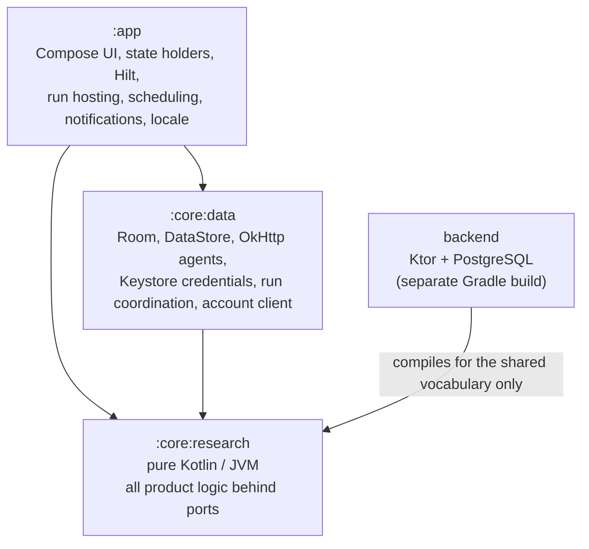

# Architecture

[← README](../README.md) · [Android](ANDROID_ARCHITECTURE.md) · [Research pipeline](RESEARCH_PIPELINE.md) · [Backend](BACKEND_ARCHITECTURE.md) · [Security](SECURITY.md) · [Testing](TESTING.md)

DailyScope has two deployable parts and one body of behavioral test data:

| Part | What it is |
|---|---|
| **Android app** | Native Kotlin / Jetpack Compose. It keeps topics, runs research with the user's own AI key, and stores and renders reports. Everything the user creates stays on the device. |
| **Account backend** | Kotlin / Ktor / PostgreSQL: accounts, sessions, devices and a server-side entitlement read model, as the foundation for later account-based features. Implemented and tested; not deployed, and the app does not call it yet. |
| **Behavioral fixtures** | Golden test cases generated from the predecessor Python desktop app, plus hand-authored specification cases for Android-only behavior. They pin what the research core must do. |

The source code of all three is private. These documents describe the design.

---

## Module boundaries

- **`:core:research` is pure Kotlin.** It holds the provider catalog, prompts, result validation and recovery, event identity and matching, change detection, report assembly and the HTML export. It also holds the runner that orchestrates a run, and the interfaces (ports) it needs: a store, an agent factory, a chat helper, a usage sink and a clock. A build task fails on any Android, AndroidX or WorkManager dependency.
- **`:core:data` implements the ports** on Android: a Room-backed store, seven OkHttp provider adapters, a chat helper, a Keystore-backed credential store, a run coordinator and reconciler, and the account client.
- **`:app` decides how a run is hosted** (a foreground service or a JobScheduler job), and draws the UI. The runner never knows its host, so manual and scheduled runs behave the same.
- **The backend reuses the research core's commercial vocabulary types** (plan and capability codes) instead of duplicating them. It never depends on an Android module.

### Portability of the pure module

The research core also runs on Android's runtime from API 26, so it avoids JDK 9+ APIs and the regex constructs on which the JVM and Android's ICU engine disagree. The same domain test suite runs on ART on emulators to catch exactly those differences.

### Porting Python semantics explicitly

The research core is a port of DailyScope's predecessor, AIOS Intelligence Monitor, a Python desktop app by the same author. Where Python and Kotlin defaults differ (string slicing by code point, JSON formatting, float formatting, URL parsing), the port goes through a small, explicit compatibility layer rather than Kotlin's defaults. The golden fixtures pin the result ([Testing](TESTING.md)).

---

## Design decisions

| Decision | Why |
|---|---|
| **Local-first.** Topics, reports, history and settings live on the device. No cloud sync. | Research output and API keys are personal. The app works with no account and no server. |
| **Bring your own key.** The user's own provider account is called directly from the device. | No server has to hold provider keys or pay for calls, and the user sees the provider's real cost. |
| **No automatic retry of paid research calls.** One primary research request plus at most one repair; short matching calls only for ambiguous events; an interrupted run ends as failed. | A retry repeats a whole research pass that costs money and can take minutes. Android can re-dispatch work after process death, so "no retry" is enforced by a claim-once transition in the runner, not by host configuration. |
| **A host-agnostic runner.** The runner has no Android imports; hosts are adapters. | The scheduled-run host changed during development (from WorkManager to a JobScheduler job) without touching the runner or its tests. |
| **No Google Play Services dependency.** JobScheduler directly; source links through Custom Tabs, falling back to a plain intent. | The app must run on devices without GMS. |
| **Native report rendering, no WebView.** Reports are Compose layouts over structured rows; model text is always plain text. | Model output is untrusted input. Rendering it as text removes a class of injection problems. |
| **A run snapshots its settings.** The run copies the topic's output preferences, and the report copies them from the run. | Changing a topic never changes an existing report, and each report records how it was made. |
| **Writing preferences are isolated from identity.** | Changing how events are written must never split or merge events. |
| **HTTPS only**, also on API 26–27 where the platform default still allows cleartext. | API keys travel in request headers. |
| **Machine codes are never translated.** Enums, error codes and stored texts keep stable values and are mapped to localized text at the UI boundary. | Persisted data and protocol values must not depend on the UI language. |

---

## Implemented vs. planned

| Area | State |
|---|---|
| Topics, AI-drafted and revised briefs, revisions | Implemented |
| Manual runs (foreground service), daily runs (JobScheduler), reconciliation | Implemented |
| Seven bring-your-own-key providers with web search; test connection | Implemented |
| Validation, deterministic local recovery, one bounded repair, truncation detection | Implemented |
| Event identity, matching, change detection (new/updated events, a Changes view, per-event timelines) | Implemented |
| A topic-level state model with richer change types (for example confirmed or reversed developments) | Planned |
| Ingesting chosen sources directly, beyond each provider's web search | Planned |
| Reports, Changes, past reports, event timeline, HTML export in four styles | Implemented |
| English and Simplified Chinese UI, per-app language | Implemented |
| Reports written in a language other than Simplified Chinese | Planned |
| Backend: one-time activation, sessions, devices, entitlement read model, admin CLI and audit log | Implemented and tested; **not deployed** |
| Android account client (session storage, single-flight refresh, entitlement read) | Implemented and tested; **not used by any screen** |
| Sign-in UI, entitlement gating, hosted AI, usage quotas, payments | **Not implemented** |
