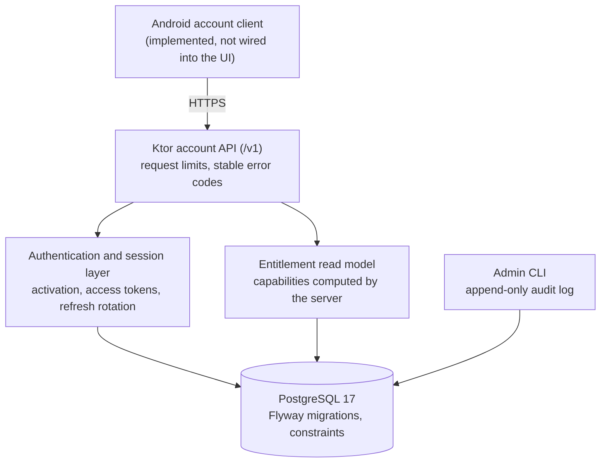

# Backend architecture

[← README](../README.md) · [Architecture](ARCHITECTURE.md) · [Android](ANDROID_ARCHITECTURE.md) · [Research pipeline](RESEARCH_PIPELINE.md) · [Security](SECURITY.md) · [Testing](TESTING.md)

The backend is the account foundation for a later, account-based version of DailyScope. **It is implemented and tested, but not deployed, and the Android app does not call it yet.** Topics, reports and settings stay on the device; there is no content sync.



| | |
|---|---|
| Language and runtime | Kotlin on JDK 21 |
| HTTP | Ktor (Netty), kotlinx.serialization |
| Database | PostgreSQL 17 through plain JDBC and a HikariCP pool (no ORM) |
| Migrations | Flyway |
| Tokens | JWT (HS256) through a standard library; JDK `SecureRandom` and SHA-256 |
| Shape | One deployable service with logical packages, plus an admin CLI in the same distribution |

It is a separate Gradle build from the Android project, and reuses the research core's plan and capability vocabulary types instead of duplicating them.

---

## Implemented

### API

- Activation with a one-time access code, token refresh, logout, logout from all devices, the current user, and the entitlement document. A health endpoint checks the database.
- Errors carry **stable machine codes** (for example "refresh token reused" or "session revoked"). Clients act on the code, never on the message.
- Requests are bounded: a body-size limit, JSON errors for malformed input, and credential-looking query parameters are refused.

### Identity and activation

- **A canonical internal user id** (UUID). External identities are linked to it, unique per provider, so a new sign-in method can be added later without migrating identity. An email address or phone number is never a primary key.
- **One-time activation codes** for a private beta, issued by an administrator: high-entropy, shown once, stored only as a hash, with an expiry and a revocation state.
- **Activation is one transaction:** lock the code row, validate it by server time, create or resolve the user, register the device, mark the code used, issue the session. **Two concurrent activations of one code can't both succeed**, and a test runs them in parallel against a real database to prove it.
- **Devices** are identified by a random installation id from the app. No hardware identifier is collected.

### Sessions

```text
activate             → access token (JWT, short-lived) + refresh token #1 (opaque)
refresh(#1)          → access token + refresh token #2        (#1 is now rotated)
refresh(#1) again    → "refresh token reused": the whole session is revoked
```

- **Access tokens** are short-lived JWTs that name the user, session and device, verified for issuer, audience and expiry by server time.
- **Refresh tokens** are opaque random values, **stored only as hashes** and **rotated on every refresh**.
- **Replay detection.** Presenting an already-rotated refresh token revokes the session, and the revocation is committed before the error is returned.
- **Concurrency.** A refresh locks its token and session rows, so a concurrent refresh with the same token waits and then sees it rotated. Partial unique indexes enforce, at the database level, one current refresh token per session and one live session per device.
- **Immediate revocation.** Every authenticated request also re-checks the session, device and user, so logout and administrative revocation take effect at once, not when the access token expires.

### Database constraints

The schema relies on PostgreSQL for its invariants, not only on application code: `CHECK` constraints on statuses and consistent state pairs (for example "revoked if and only if a revocation time is set"), unique and partial unique indexes, and triggers that make the audit log append-only. Schema changes are new Flyway migrations; an applied migration is never edited.

### Entitlement read model

- Plans and their capabilities are **data defined by an administrator**, not code.
- At most one open entitlement per user, enforced by a partial unique index; concurrent grants are tested.
- **The server computes the capabilities** from the active entitlement and server time, and returns them as codes. Clients never derive capabilities from a plan name, and they ignore codes they don't know.

### Admin CLI and audit log

One executable provides `serve`, `migrate` and administrative commands for codes, users, plans, entitlements, sessions and devices.

- Every mutation writes the audit log **in the same transaction**, and the log rejects updates and deletes.
- The CLI prints a new code once, and never prints passwords, signing secrets, tokens or hashes.
- Failures print a stable error code and exit non-zero.

### Configuration

Configuration comes only from environment variables, validated at start-up. A password inside the database URL is refused, the signing secret has a minimum length, and the configuration's string form redacts secrets.

---

## Not implemented

- **Planned product features:** hosted AI, usage quotas and payments.
- **Operations:** deployment, TLS termination, backups, rate limiting, signing-key rotation and account deletion are planned for the first deployment.
