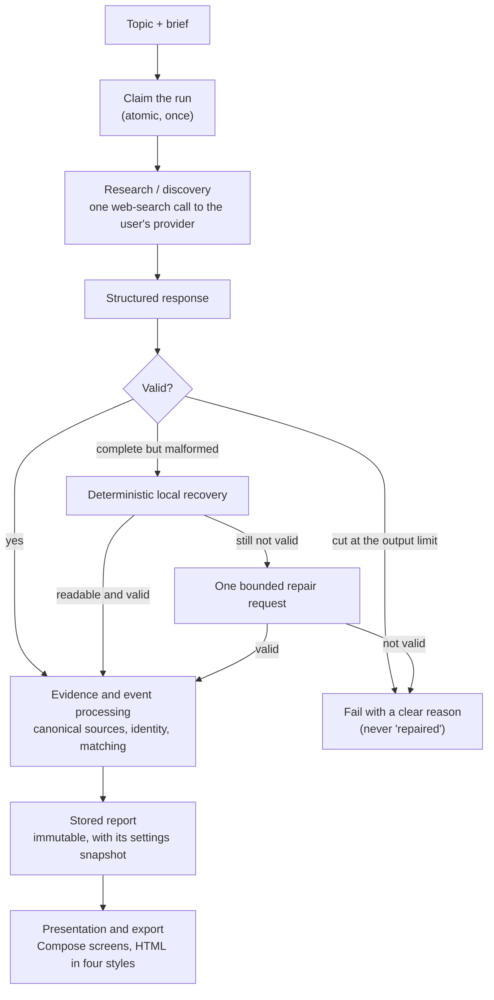

# Research pipeline

[← README](../README.md) · [Architecture](ARCHITECTURE.md) · [Android](ANDROID_ARCHITECTURE.md) · [Backend](BACKEND_ARCHITECTURE.md) · [Security](SECURITY.md) · [Testing](TESTING.md)

One research run turns a topic into a stored report. This page describes the stages and the guarantees each one gives. The prompts, the matching rules and their parameters, and the recovery algorithms are part of the private implementation and are described here only at the level of what they guarantee.

The orchestration is one runner in the pure-Kotlin core, behind ports. The same code runs in a foreground service, in a JobScheduler job and in JVM tests with a scripted agent. Each checkpoint is one short store transaction, and no network call ever runs inside a transaction.

---

## 1. Claim

The run starts with an atomic `pending → running` transition, before any network access. A run that is not pending returns without a request. This keeps "one paid call per run" true when Android re-dispatches a host after process death ([Android](ANDROID_ARCHITECTURE.md#background-execution-jobscheduler-and-a-foreground-service)). A missing or archived topic fails the run before anything is sent.

## 2. Research and discovery

The request is built from the topic's brief: the research window, the preferred sections from the topic's report history, the search depth and the report date in the device's time zone. The output preferences come from **the run's snapshot**, not from the topic, and the brief version that was read is recorded on the run.

The prompt asks for a strict JSON result. The output preferences only change one clearly separated part of the prompt, which governs how qualifying events are written. A test checks, for each of the seven provider adapters and all 27 preference combinations, that the request bodies differ only in that prompt text.

Each provider adapter makes one call with its own web-search tool and records the vendor's stop reason, the searches made, token usage and latency. A DeepSeek reply that shows no web search at all is an error, never a report.

## 3. Structured response and validation

- **Truncation first.** A reply cut at the output limit is detected from the vendor's own stop reason and fails the run with a message that explains why. A truncated reply is never "repaired" into a plausible-looking result.
- **Strict validation.** The JSON is extracted and validated against the result schema: required fields, types, exact length and list limits, tolerant number coercion, and URL resolution. An event is admissible only through sources that resolve to a returned source.
- **Coverage.** The result declares complete, partial or failed coverage. Failed coverage fails the run; partial coverage publishes a report marked as degraded, with its coverage notes.

## 4. Deterministic recovery, then at most one bounded repair

- **Local recovery** runs only when a *complete* reply has no readable JSON. It is a mechanical repair of common formatting mistakes: it keeps every character of the model's text and never guesses missing content. A recovered object that is still invalid is not accepted.
- **One repair request** is made only after a parse or validation failure. If the repair reply is itself cut at the limit, the run fails with a separate message.

So a run makes **at most two provider requests**, and network and HTTP errors are never retried. Usage records note when recovery was used; the reply itself is never stored there.

## 5. Evidence and event processing

- **Evidence.** Each source is stored once, under a canonical URL and its hash.
- **Event identity.** Each event is matched against the topic's recent events. Deterministic rules settle the clear cases without a model call. Ambiguous cases may go to a small, separate model judgement; if that helper is unavailable or fails, a deterministic rule decides. **When unsure, the event is new**: a false "update" is worse than a duplicate.
- **Neutral facts only.** Matching reads only the neutral fields and the primary citations. The preference-shaped writing and background citations never reach identity, matching, confidence or change detection, so changing the output preferences can't split or merge events.
- **Create or update.** A new event gets a stable key; a matched event accumulates what is known about it. Each run adds an observation with its facts, its writing and its source links.
- A failure on one event is recorded as a run error, and the rest continue.

## 6. Stored report

The report is assembled from the run's observations: a focus item, sections with each item marked **new** or **updated** and given a confidence level, trends, metrics, what to watch next, and the coverage notes. It copies the run's preference snapshot and is immutable afterwards.

**Changes view.** Each report is compared with the topic's previous one, and every event is classified as new, updated, unchanged or resolved.

The run ends `completed`, `completed_with_errors`, `failed`, or `cancelled` (only when the user asked for it). The final write cannot be cancelled, and every stored error message is redacted first ([Security](SECURITY.md)).

## 7. Presentation and export

Reports are rendered natively in Compose and exported as self-contained HTML in four presentation-only styles ([Android](ANDROID_ARCHITECTURE.md#report-rendering)).

---

## The lighter chat helper

Drafting a brief from a sentence, revising it from an instruction, and the matching judgement use a lighter chat call on the same provider, with JSON output. It is bounded too: a small number of attempts with backoff, and rate-limit, balance and authentication errors are never retried. `Test connection` makes one attempt and never throws.
